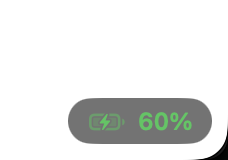

# Battery Peek

A tiny macOS app that shows your battery level in a corner of the screen, floating above all other windows — including full-screen apps.



## Features

- Small pill with a battery icon and percentage, always on top, on every Space and over full-screen apps
- Click-through: it never blocks the mouse
- Color-coded: green when charging or plugged in, yellow at ≤ 20%, red at ≤ 10%
- Flashes yellow when the battery is under 3% and not plugged in
- Updates instantly on power changes (IOKit notifications), with a 60-second fallback poll
- Menu bar icon to pick the corner (remembered between launches) or quit
- No Dock icon, no dependencies — a single Swift file

## Requirements

- macOS 13 or later, Apple Silicon
- Xcode Command Line Tools (`xcode-select --install`) for `swiftc`

## Build and run

```sh
./build.sh            # builds build/BatteryPeek.app
open build/BatteryPeek.app
```

To install into `/Applications`:

```sh
./build.sh --install
```

To start it at login, add Battery Peek in **System Settings → General → Login Items**.

## Project layout

```
Sources/main.swift   the entire app (AppKit + SwiftUI)
build.sh             compiles, writes Info.plist, ad-hoc signs the bundle
```

## License

[MIT](LICENSE)
